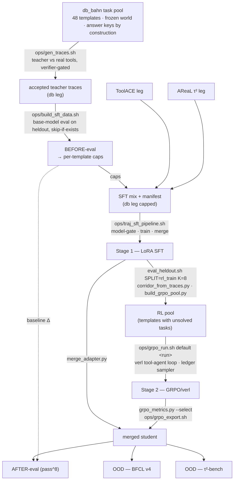

# Agentic SLM Training Pipeline

> Training a **small-language-model orchestrator agent** — multi-step planning, tool-calling and
> self-reflection/replan — for an internal **Deutsche Bahn employee assistant**.


## What is this?

A full training pipeline for a **4B agent** that drives real German DB tools — *Fahrplan*,
*Zugstandort*, *Wartung*, *Personal* — planning across several tool calls, recovering from errors
and replanning when a tool rejects an action. It runs on a single **GB10 (DGX Spark, 128 GB unified
memory, sm_121)** with vLLM serving and a [τ²-bench](https://github.com/sierra-research/tau2-bench)
tool sandbox.

Two training stages, both grounded in the same domain:

1. **Stage 1 — SFT (LoRA)** on a **3-leg mix**: public tool-calling breadth (ToolACE), τ²-bench
   dialogue flows (AReaL — airline + retail; telecom dropped), and — the core of this repo —
   **self-synthesized, verifier-gated German DB trajectories with native thinking**.
2. **Stage 2 — GRPO/verl RL** against the same db_bahn tools, reward = the same deterministic
   trajectory verifier. The pool is measured, not assumed: every `rl_train` task is rolled 8× with the
   SFT model, the templates it does not solve consistently form the pool, and a ledger re-weights the
   tasks while training. Success metric: heldout **pass^8**.

## Architecture

Generate tasks whose correct answer is **known by construction**, let a strong teacher solve them
against the *real* tools with thinking enabled, and keep only trajectories a deterministic verifier
confirms. Before the student sees them, the verified German trajectories are **capped per template
by what the base model already solves** (a heldout base-eval drives band caps, automated in
`ops/build_sft_data.sh`) and mixed with two public legs. Stage 2 then measures where the SFT model
still wavers, builds the RL pool from exactly those templates, trains with GRPO against the real tools
and is judged by the same heldout eval.



## The db_bahn domain

- **Frozen world-state.** Real [gtfs.de](https://gtfs.de) *de_fv* timetables (© gtfs.de /
  DELFI e.V., CC-BY-4.0; snapshot committed under `data/raw/db_sandbox/gtfs_de_fv/`) plus
  `sha256`-seeded synthetic tables (vehicles, staff, shifts, maintenance) → one byte-reproducible
  `db.json` (seed 42).
- **A τ²-bench domain, `db_bahn`.** 13 German tools with a German `policy.md`, *runtime-registered*
  so the upstream tau2 source stays untouched. WRITE tools enforce real rules (role-gate, product
  qualification, duplicate-gate, terminal status) → rejected actions force the agent to **replan**.
  Search pages at 10 hits, `mitarbeiter_suchen` resolves ambiguous names, `anschluss_pruefen` does
  transfer-time math; injectable faults include data gaps and **transient errors** (retry mandated
  by policy, never hinted in the ticket).
- **48 task templates** with **by-construction answer keys** — INFO + ACTION + **REFUSAL** (correct
  answer: change nothing, justify), batch/parallel tickets, iteration-over-hits, aggregation,
  cascades, Umlauf ambiguity, >10-hit refinement. Tickets state goals and anchors, **not
  tool-by-tool recipes**. ~43 % carry faults (`state` / `runtime` / `state+runtime` / `transient`).
- **Thinking-native generation** ([rollout.py](sdg_pipeline/db_bahn/rollout.py)): reasoning is
  captured inline as `<think>…</think>`, parallel multi-call turns are possible, and a token-capped
  or looping think counts as a **failed attempt** — re-rolled via `branch-on-fail` / `k=2` top-up /
  `B2` recovery-harvest.
- **A deterministic outcome-verifier**
  ([evaluation/trajectory_reward.py](evaluation/trajectory_reward.py)): DB-state hash +
  tool-grounding + anti-hallucination + refusal gates (`no_write`, `no_forbidden`). Only
  `accepted()` trajectories survive; `format_traj` additionally drops truncated/degenerate/≥3×-call
  traces. Scenario suite: 21 cases (`tests/test_trajectory_reward.py`, `bash ops/run_tests.sh`).

**Tools (13)**

| Category | # | Tools |
|----------|---|-------|
| Lookup (READ, by id) | 6 | `fahrplan`, `verspaetung`, `zugstandort`, `wartung_status`, `mitarbeiter_info`, `mitarbeiter_details` |
| Search (READ, by filter) | 3 | `zuege_suchen`, `mitarbeiter_suchen` (incl. `name`), `wartung_liste` |
| Compute (READ) | 1 | `anschluss_pruefen` (transfer feasibility incl. live delays) |
| Write (rule-gated) | 3 | `wartung_einplanen`, `crew_zuweisen`, `wartung_status_setzen` |

**Splits** (from `gen_tasks.py`; disjoint by construction, HARD-FAIL-checked; **uniform per
template** — so every class is individually measurable)

| Split | Tasks | Rule | Purpose |
|-------|-------|------|---------|
| `sft_train` | 13,948 | rest | teacher rollouts → SFT traces |
| `rl_train` | 960 | 20 / template | corridor measurement (8 rollouts / task) → Stage-2 pool |
| `heldout_eval` | 480 | 10 / template | before/after pass^8 eval (K=8) + source of the db-leg caps + verl validation set |
| `bakeoff_dev` | 48 | 1 / template | smoke/dev subset (⊆ `sft_train`) |

## Setup

Prereqs: **Docker + Compose with the NVIDIA Container Toolkit** (the compose services reserve GPUs
via `driver: nvidia`; services `sdg`, `training`, `vllm`, `vllm-user`, `grpo`, `mlflow`; Stage 2 runs in
the frozen verl image `agentic-grpo:verl`, recipe `docker/Dockerfile.grpo-agentic`), a host `python3` ≥ 3.12,
and a **Python ≥ 3.12 venv for τ²-bench** (its `requires-python >=3.12`; the pinned training stack
stays isolated in the containers). Host-side data scripts are stdlib-only — no pip install on the
host.

```bash
# clone this repo (full clone — ships the frozen GTFS snapshot + golden hashes)
git clone https://github.com/JanneckGit/slm-agentic-training-pipeline.git
cd slm-agentic-training-pipeline

# τ²-bench dependency, isolated in its own venv, installed from the frozen lock: tau2 1.0.0 @ 1901a30
# built from GitHub + every transitive version this pipeline was run with (+ pytest for the tests).
# Runtime dep of the db_bahn domain — the τ²-bench OOD benchmark pins its own newer checkout, see OOD section.
python3.12 -m venv .venv-tau2
./.venv-tau2/bin/pip install --no-deps -r requirements/tau2.lock.txt
# upgrading instead: pip install a newer tau2-bench checkout, then `bash ops/freeze_venvs.sh` refreshes the locks
```

Rollout/eval scripts default to `.venv-tau2/` (override with `TAU2PY=/path/to/python`); the data
chain (`ops/build_sft_data.sh`) runs on host `python3`. Two more venvs exist only for the optional
OOD benchmarks (`.venv-bfcl`, `.venv-tau2bench` — see the OOD sections); all three are frozen in
`requirements/*.lock.txt` (`bash ops/freeze_venvs.sh` refreshes them). Two configs, no secrets:
`config/pipeline_config.yaml` (SDG / SFT / eval) and `config/grpo_db_bahn.yaml` (Stage 2) — the teacher
is local vLLM and all models are public. The first serve pulls weights into the repo-local,
gitignored `data/hf_cache/` (every container sees it as `/data/hf_cache`, the BFCL/τ² harnesses use it
as host `HF_HOME`; create it as your user before the first container start, otherwise Docker creates it
root-owned) — student Qwen3-4B ≈ 8 GB, teacher Qwen3.6-35B-A3B ≈ 67 GB. `HF_TOKEN` is optional
(all models are public); Compose reads it from `docker/.env` — template in `docker/.env.example`.

**Data prerequisites.** The GTFS snapshot ships with the repo (`data/raw/db_sandbox/gtfs_de_fv/` —
frozen gtfs.de *de_fv* feed of 2026-06-27, 2.8 MB, © gtfs.de / DELFI e.V., CC-BY-4.0). It anchors
the byte-reproducible golden hashes (`db.json`, task pool); a fresh feed would be a different
world with different hashes. The two public legs are fetched by `prepare_agentic_data.py` (step 0
below); everything else under `data/` is generated by the pipeline.

**Import convention:** scripts import the shared `data_pipeline/common.py`, so host invocations need
the repo root on the path — prefix with `PYTHONPATH=.` (as the examples do), or install once via
`pip install -e . --no-deps` (containers bake `PYTHONPATH=/app`).

## Running the pipeline

**CPU** (host `python3` unless marked `[TAU2PY]`):

```bash
# 0) public legs -> data/raw/{toolace,areal}/   (areal = ~970 MB snapshot)
PYTHONPATH=. python3 data_pipeline/prepare_agentic_data.py --config config/pipeline_config.yaml --dataset all
PYTHONPATH=. ./.venv-tau2/bin/python data_pipeline/validate_areal.py --config config/pipeline_config.yaml

# 1) frozen world-state from the GTFS snapshot (byte-reproducible, seed 42)
python3 sdg_pipeline/db_bahn/seed_worldstate.py --gtfs-dir data/raw/db_sandbox/gtfs_de_fv \
  --out data/raw/db_sandbox/db.json --seed 42

# 2) tasks + answer keys + uniform splits (defaults reproduce the golden artifacts)   [TAU2PY]
PYTHONPATH=. ./.venv-tau2/bin/python sdg_pipeline/db_bahn/gen_tasks.py --seed 42

# 3) GPU-free end-to-end smoke: scripted oracle through the REAL loop + verifier      [TAU2PY]
#    (--max-turns 15 is required — the depth templates need up to 13 calls)
PYTHONPATH=. ./.venv-tau2/bin/python sdg_pipeline/db_bahn/rollout.py \
  --dry-run --split bakeoff_dev --max-turns 15 --output /tmp/oracle_smoke.jsonl

# tests — pytest in the tau2 venv (verifier scenario suite, sampler, backfill) + the loss-mask golden
# test in the training container, started GPU-free (docker/docker-compose.cpu.yml — a test run never
# touches the shared GPU); SKIP_CONTAINER=1 runs the pytest part alone. CI runs the same from
# requirements/tau2.lock.txt (.github/workflows/tests.yml).
bash ops/run_tests.sh
```

**GPU** (sequential — GB10 has no MIG, serve one model at a time):

```bash
bash ops/teacher_bakeoff.sh     # compare teacher candidates on bakeoff_dev
bash ops/gen_traces.sh          # serve winner -> thinking rollout over sft_train (k=1 branch-on-fail)
                                #   -> k=2 top-up -> format ->
                                #      data/generated/legs/db_traces_chat.jsonl        (the SFT input)
                                #      data/generated/sdg/db_failed-for-SFT_rl-candidates.jsonl
                                #                       (tasks in no verified trace — diagnostic only; the
                                #                        Stage-2 pool comes from the corridor measurement)
                                #   (defaults: ctx 20480, concurrency 48, 72 h cap; ~41 h on GB10)
```

`gen_traces.sh` runs 40+ hours — start it detached, with the watchdog next to it:

```bash
tmux new-session -d -s sdg -c "$PWD"
tmux send-keys -t sdg:0.0 'bash ops/gen_traces.sh > logs/gen_traces.log 2>&1' Enter
tmux split-window -t sdg:0 -v -c "$PWD" \; send-keys 'ops/watch_gen.sh' Enter
```

`ops/watch_gen.sh` writes progress, rate, ETA and server health to `logs/gen_watch.log` every 10 min
and flags a stall if the trace file stops growing for 30 min. The rollout itself is resume-safe:
rerunning the script continues where it stopped.

**Mix + train** (`build_sft_mix.py` needs `db_traces_chat.jsonl` from the step above):

```bash
PYTHONPATH=. python3 data_pipeline/convert_toolace.py     # bracket-DSL -> toolace_preselect.jsonl
bash ops/toolace_backfill.sh                              # teacher generates thinking, gold-verified
                                                          #   -> toolace_chat.jsonl  (GPU, ~11 h)
docker compose -f docker/docker-compose.yml run --rm -T training \
  python3 data_pipeline/convert_areal.py                  # per-turn rows -> episodes (airline+retail,
                                                          #   telecom dropped, parallel-ban stripped)
bash ops/build_sft_data.sh                                # base-eval (skip-if-exists) -> per-template
                                                          #   caps -> sft_mix_chat/val_<label>.jsonl
                                                          #   + canonical symlinks + manifest
                                                          #   (bare build_sft_mix.py refuses to write
                                                          #   through the canonical symlinks)

bash ops/traj_sft_pipeline.sh   # precondition+model-gate -> traj_sft -> merge x3 -> AFTER-eval x3
                                #   -> checkpoint-selection (best of ep1-3)
```

**Stage 2 — GRPO (verl)** — every knob lives in `config/grpo_db_bahn.yaml`. A profile is a configuration
variant (`default`, `smoke`, `smoke_static`); the run name is given on the command line and names the run's
folders, and each run keeps the configuration it was started with in `runs/<run>/resolved_config.json`.
The preflight runs inside the container and blocks on pool, init fingerprint, tool registry, flags,
reward-parser round-trip, prompt length and run state. Ledger, sampler state and dumps land in
`data/final/grpo/runs/<run>/`, verl checkpoints in `data/final/grpo/verl_ckpt/<run>/`:

```bash
# corridor: 8 rollouts per rl_train task with the SFT model -> the templates it does not solve consistently
SPLIT=rl_train K=8 TEMPERATURE=1.0 MLFLOW_EXPERIMENT=db_bahn_rl_corridor \
  bash ops/eval_heldout.sh /app/data/final/checkpoints/db_bahn_traj_merged_qwen3-4b/selected <label>
python3 evaluation/corridor_from_traces.py --input data/generated/eval/db_traces_rl_train_<label>_k8.jsonl
GRPO_IMAGE=agentic-grpo:verl docker compose -f docker/docker-compose.yml --profile grpo run --rm -T grpo \
  training_pipeline/build_grpo_pool.py --corridor /app/data/generated/eval/rl_corridor_<label>_k8.json \
  --traces /app/data/generated/eval/db_traces_rl_train_<label>_k8.jsonl --pool-id <pool-id>   # then set paths.pool_dir

bash ops/grpo_run.sh smoke                         # 2-step smoke: preflight -> verl -> 24-task validation
bash ops/grpo_run.sh default <run>                 # the run (tmux); rerun the same command to resume
python3 training_pipeline/grpo_metrics.py <run> --select   # ledger stats, exact pass^8, stop rule, `selected` (--mlflow: inside the grpo container)
bash ops/grpo_export.sh <run> selected             # verl checkpoint -> LoRA adapter -> merged model
bash ops/eval_heldout.sh /app/data/final/checkpoints/db_bahn_grpo_merged_qwen3-4b/<run>/step_<N> after_<run>
```

**In-domain eval, standalone** — any model (base, merged checkpoint, experiment), **K=8 rollouts per
task** (default) over the 480 `heldout_eval` tasks, printing per-template **pass^8** and mean; `K=<n>`
overrides it (the output file carries a `_k<K>` suffix for K≠1, the MLflow run name too). `RESUME=1` continues an
interrupted run; a sidecar (`<out>.meta.json`: model, label, split, K, sampling, serve flags) must match, otherwise it aborts:

```bash
bash ops/eval_heldout.sh Qwen/Qwen3-4B base_qwen3-4b                 # -> …_base_qwen3-4b_k8.jsonl
python3 evaluation/eval_report.py --input <eval.jsonl> [--baseline <eval.jsonl>]   # re-report / delta (pass^k for k>1)
```

`build_sft_data.sh` (BEFORE, reused as caps source) and `traj_sft_pipeline.sh` (both AFTER evals)
call this same script, so those numbers are comparable by construction.

**OOD benchmark (BFCL v4)** — external harness in its own venv, driven by one ops script per model.
Setup is **two steps**: the frozen venv (it carries the `numpy>=2` override — without it `faiss` fails
to import on aarch64/py3.12 and the whole `memory` group drops out) and the embedding model that feeds
`memory_vector` — the preflight gates both:

```bash
python3.12 -m venv .venv-bfcl && .venv-bfcl/bin/pip install --no-deps -r requirements/bfcl.lock.txt
#   (unfrozen: pip install -r evaluation/benchmarks/bfcl/requirements.txt && pip install "numpy>=2.0")
docker compose -f docker/docker-compose.yml run --rm -T sdg python3 -c \
  "from huggingface_hub import snapshot_download; snapshot_download('sentence-transformers/all-MiniLM-L6-v2')"
```

```bash
bash ops/eval_bfcl.sh Qwen/Qwen3-4B qwen3-4b_base            # 20 of 22 scoring categories, 5,017 items
bash ops/eval_bfcl.sh /app/data/final/checkpoints/db_bahn_traj_merged_qwen3-4b/ep3 qwen3-4b_sft-ep3
BFCL_CATEGORIES=non_live bash ops/eval_bfcl.sh Qwen/Qwen3-4B qwen3-4b_base           # optional: single group

python3 evaluation/benchmarks/bfcl/bfcl_report.py --run data/generated/eval/bfcl/qwen3-4b_sft-ep3 \
                                                  --baseline data/generated/eval/bfcl/qwen3-4b_base
```

One run directory per model under `data/generated/eval/bfcl/<label>/` (model first, so `ls` groups a
model's runs), each with a `run_manifest.json` carrying the resolved checkpoint, its fingerprint and
the sampling actually used. `preflight.py` injects a per-model registry entry so bfcl budgets
`max_tokens` against the served model's true context window, and refuses to serve until deps,
sampling recipe, label, embedding model and both sides of the context window check out;
`bfcl_report.py` separates a model's context limit from a retryable connection drop instead of
scoring both as failure.

**One invocation runs everything** — the script splits concurrency per group (48 for the short-item
categories, 21 for the chain-bound ones; measured, env-overridable). Budget **~6–9 h per model**;
resume is the same command — run it in tmux.

**OOD benchmark (τ²-bench)** — the main before/after yardstick around GRPO: multi-turn
conversations against an LLM user simulator (dual control), pass^k over 4 trials. Setup is one
pinned checkout as task data (`TAU2_DATA_DIR`) plus the frozen venv (tau2 built from the same v1.0.1
commit); the preflight gates commit, package version, task counts and a data fingerprint:

```bash
git clone --branch v1.0.1 --depth 1 https://github.com/sierra-research/tau2-bench data/raw/tau2-bench   # = TAU2_DATA_DIR
python3.12 -m venv .venv-tau2bench && .venv-tau2bench/bin/pip install --no-deps -r requirements/tau2bench.lock.txt
#   (frozen: tau2 1.0.1 from the v1.0.1 commit + rank_bm25 for banking retrieval — the preflight gates both)
```

```bash
bash ops/eval_tau2.sh Qwen/Qwen3-4B qwen3-4b_base                    # all 4 domains × 4 trials (375 tasks)
bash ops/eval_tau2.sh /app/data/final/checkpoints/db_bahn_traj_merged_qwen3-4b/selected qwen3-4b_sft-ep3
bash ops/eval_tau2.sh Qwen/Qwen3-4B qwen3-4b_base telecom            # optional: single domain
```

Everything else is automatic: the preflight **auto-sizes GPU budgets and concurrency from the
agent model's weight size** (4B → 0.22/0.64 @ MC 12, 8B → 0.25/0.61 @ MC 8 — swept; an 8B run
needs no extra flags), serves agent (:8000) and the frozen user simulator Qwen3.6-35B-A3B (:8001)
sequentially with per-model tool parsers, calibrates the harness via a ground-truth agent on
`mock`, and resumes with the same command. Scoring is deterministic except retail, whose NL
assertions are judged by the local simulator model (shim — no paid APIs anywhere).
telecom + banking_knowledge are the strict held-outs; airline/retail share the AReaL SFT world
(tasks measured disjoint) and are reported with an asterisk. Results land in
`data/generated/eval/tau2/<label>/` + MLflow (`tau2_eval`); absolute scores are not
leaderboard-comparable (local user sim) — the Base↔ep3 delta is the measurement. Budget
**~4.5–5.5 days per model** for the full set (telecom alone ≈ 1.5–2 days).

## Training recipe (Stage 1)

What `ops/traj_sft_pipeline.sh` launches:

| Knob | Value | Why |
|------|-------|-----|
| Base | **Qwen/Qwen3-4B** (dense, text-only, thinking) | no multimodal baggage; verl-GRPO-proven on sm_121 |
| LoRA | **r=32 / α=64**, all 7 linear modules | capacity for a broad task (3 domains + tools + German) |
| Seq len | **12,288** | AReaL episodes run long; truncating them costs quality |
| Batch | micro **8** × accum **2** = **eff. 16** | micro 16 was tested → *slower* (padding/saturation) |
| Epochs | **3**, cosine, lr 2e-4, warmup 3 % | capped mix has fewer steps/epoch; checkpoint-selection picks the best of ep1–3 |
| Speed | **FA2** + **Liger** (fused CE) + `group_by_length` | Liger is **required** for micro > 4 @ 12k (removes the 55 GB fp32 logit tensor) |
| Regularization | **NEFTune α=5** | noisy input embeddings, train-time only ([arXiv:2310.05914](https://arxiv.org/abs/2310.05914)) |
| Eval | held-out val + `eval_steps 300` | overfit diagnostic only — the real judge is the rollout `verified_yield` |

## Training recipe (Stage 2)

What `ops/grpo_run.sh default <run>` launches (`config/grpo_db_bahn.yaml`, profile `default` = base):

| Knob | Value | Note |
|------|-------|------|
| Vehicle | **verl 0.8.0** (frozen image `agentic-grpo:verl`) | in-process vLLM rollout + tool-agent loop against the real tau2 env |
| Init | merged SFT ep3 + **fresh LoRA r=16 / α=32** | the RL adapter is merged into ep3 afterwards (`ops/grpo_export.sh`) |
| Algorithm | **Dr.GRPO** (advantage = reward − group mean), no KL (switch), lr 2e-5 with 4 warmup steps, then constant | **two updates per step**: mini-batch 8 of the 16 prompts, the PPO clip (0.2) covers the slightly off-policy second half |
| Step / epoch | **16 prompts × 8 rollouts**; epoch = 128 draws = 8 steps | checkpoint + validation every epoch |
| Pool | all tasks of every template with ≥1 corridor task (1–7 of 8 successes) | `build_grpo_pool.py`; corridor tasks are the core, their 8/8 siblings hedge the measurement noise |
| Sampling | ledger-driven weights p̂(1−p̂) with p̂ = 0.7·own rate + 0.3·template rate, low-variance resampling, aging for failed tasks; `static` switch | `CorridorDataset` (`grpo_dataset.py`) reads the ledger `grpo_reward.py` appends to |
| Rollout | thinking on, temp 1.0 / top_p 0.95 / top_k 20; prompt 6144 + response 8192; 15 assistant + 15 user turns; up to 10 parallel calls | same verifier and tool truncation as SFT/eval |
| Reward | binary `trajectory_reward.py` via `grpo_reward.py` (episode text → messages → replay on a fresh DB) | parser round-trip is a preflight gate |
| Validation | full heldout, **K=8**, temp 0.6, every epoch + step 0 | exact pass^8 from the dumps (`grpo_metrics.py`) |
| Stop / select | informative-group share < 20 % · 3 validations without a new heldout best · 15-epoch cap → best exact pass^8 (`--select`) | applied by the watcher via `grpo_metrics.py`; nothing selected if step 0 is not beaten |
| Memory | rollout share 0.30, validation in batches of 16 tasks (128 live episodes), dataloader workers 0, micro-batch 1 | rollout vLLM, FSDP actor and one tau2 env per live episode share the 128 GB unified memory |

## Repo layout

```text
sdg_pipeline/db_bahn/            grounded synthesis
├── seed_worldstate.py           GTFS + seeded tables -> frozen db.json
├── gen_tasks.py                 template registry, answer keys, splits
├── gen_tasks_lib.py             eligibility pools + ticket building blocks
├── gen_templates_easy.py        ┐
├── gen_templates_hard.py        ├ the 48 templates
├── gen_templates_wave3.py       ┘
├── rollout.py                   rollouts vs the real tools
├── bakeoff_summary.py           teacher comparison table
└── tau2_domain/                 13 tools, policy.md, world data model

data_pipeline/                   raw data -> training jsonl
├── prepare_agentic_data.py      fetch ToolACE + AReaL
├── validate_areal.py            schema / integrity / referential checks
├── convert_toolace.py           bracket-DSL -> preselection (parallel-first, gold calls)
├── backfill_toolace_think.py    teacher generates thinking, verified against the gold call
├── convert_areal.py             per-turn rows -> episodes (airline+retail; strips the parallel-call ban)
├── format_traj_for_training.py  rollouts -> chat, split-aware gates
├── derive_db_caps.py            heldout base-eval -> per-template caps (model-aware downweighting)
├── build_sft_mix.py             3-leg mix (db capped via --db-caps) + stratified val split + manifest
└── common.py                    shared helpers

training_pipeline/               Stage 1 SFT · Stage 2 GRPO layer around verl
├── train_traj.py                LoRA SFT
├── collator_multiturn.py        assistant-only loss mask (final turns)
├── build_grpo_pool.py           corridor measurement -> pool parquets (train / val / smoke_val) + manifest
├── grpo_sampling.py             pool math: smoothed weights, low-variance resampling, aging (--selftest)
├── grpo_dataset.py              CorridorDataset: verl dataset that draws by ledger weights
├── grpo_config.py               grpo_db_bahn.yaml profile -> verl flags, memory budget, paths
├── grpo_preflight.py            container-side gates before every run
├── grpo_metrics.py              ledger + validation dumps -> informative share, exact pass^8, stop rule, selection
├── grpo_db_bahn_tools.py        the tau2 tools as verl BaseTools
└── grpo_tool_config.yaml        verl tool registry

evaluation/
├── trajectory_reward.py         the verifier = the Stage-2 reward
├── grpo_reward.py               verl seam: episode text -> messages (+ ledger line per rollout, round-trip self-test)
├── eval_report.py               per-template pass^k + mean table, optional baseline delta
├── corridor_from_traces.py      k-sample rollout JSONL -> per-task success rates (the corridor file)
├── benchmarks/bfcl/             BFCL v4 harness glue
│   ├── preflight.py             CPU-only gate (deps, registry, sampling, context) + run manifest
│   ├── registry_inject.py       runtime registry entry per served model
│   ├── run_bfcl.py              injection shim around the bfcl CLI
│   ├── bfcl_report.py           per-category table + delta + think%/zero_input/at_cap diagnostics
│   ├── log_mlflow.py            scores -> MLflow experiment bfcl_eval
│   └── make_smoke_ids.py        deterministic ID lists for smokes and probes
└── benchmarks/tau2/             τ²-bench harness glue
    ├── benchmark_config.yaml    frozen benchmark definition (user sim, sampling, trials, autosize)
    ├── preflight.py             CPU-only gates (pins, task counts, keys, frozen sim) + GPU auto-sizing + run manifest
    ├── run_tau2.py              shim: patches the NL-judge constants to local endpoints, then the tau2 CLI
    ├── tau2_report.py           pass^k (official formula) + component rates + error taxonomy + think-leak gate
    ├── log_mlflow.py            metrics -> MLflow experiment tau2_eval
    ├── check_disjoint.py        AReaL SFT leg vs official tasks — contamination gate
    ├── data_fingerprint.txt     pinned sha of the task data
    └── requirements.txt         setup notes (install = the pinned checkout itself)

serving/merge_adapter.py         LoRA -> merged sharded model
tools/quantize_fp8.py            FP8 deploy quantization
ops/                             teacher_bakeoff · gen_traces · watch_gen · toolace_backfill ·
                                 eval_heldout · eval_bfcl · eval_tau2 · build_sft_data · traj_sft_pipeline ·
                                 grpo_run · grpo_export · run_tests · freeze_venvs
tests/                           pytest — verifier scenario suite (21 cases) + wrappers for the three module self-tests
requirements/                    frozen venvs (tau2 · tau2bench · bfcl): pip install --no-deps -r …; ops/freeze_venvs.sh refreshes
.github/workflows/tests.yml      CI — the same tests from the tau2 lock (fixtures regenerated + cached) + the collator job
docker/                          GB10 sm_121 stack · docker-compose.cpu.yml = GPU-free override for the test runner
config/pipeline_config.yaml      SDG / SFT / eval config
config/grpo_db_bahn.yaml         Stage-2 config (profiles default, smoke, smoke_static)
data/, archive/                  [gitignored]
```

## GB10 / sm_121 load-bearing flags

Mandatory on this box: FlashInfer sampler off (top-k/top-p race), `--gdn-prefill-backend triton`
**for the hybrid-GDN teacher only** (never for the dense 4B student), sharded merges
(`max_shard_size=5GB`), no MIG → one model at a time — **except the τ²-bench dual-serving pair**
(agent + user sim), which budget-splits the card via preflight auto-sizing and must start
sequentially. Tool parsers differ per Qwen generation (`hermes` for Qwen3-4B/8B, `qwen3_xml` for
Qwen3.6), and `--reasoning-parser` is mandatory for τ² but forbidden for BFCL/heldout (they parse
`<think>` client-side). For Stage 2 additionally:
`load_format=auto` (else the rollout serves random weights), `attn_implementation=sdpa` (FA2 fails
the actor forward on sm_121), `rollout.agent.default_agent_loop=tool_agent` (`multi_turn.enable`
alone is a no-op), `multi_turn.max_parallel_calls` raised (the default 1 silently drops parallel
tool calls), user-turn cap = assistant-turn cap (tool results count as user turns) and micro-batch 1
(no `remove_padding` on sm_121, so larger micro-batches only pad). All applied in
`config/grpo_db_bahn.yaml` and the `ops/` scripts.
